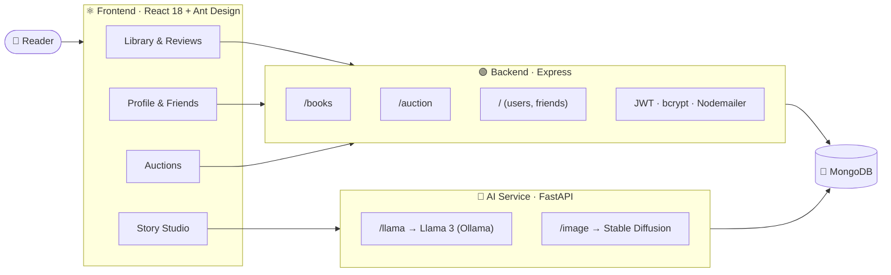

<!-- ═══════════════════════════ HEADER ═══════════════════════════ -->
<p align="center">
  
</p>

<p align="center">
  
</p>

<p align="center">
  
  
  
  
  
  
  
</p>

<p align="center">
  
  
  
  
</p>

---

## ✨ The idea

> *Reading is solitary. Talking about books shouldn't be.*

**StoryGram** puts a reader's whole life with books in one place. You can build a personal library, lend and review books, find friends with similar taste, bid on rare copies in live auctions, and, when you'd rather write than read, **draft your own story with a local LLM and illustrate it with AI-generated art**.

It runs as **three cooperating services**: a React client, an Express/MongoDB API that handles identity and social data, and a Python AI service that does the generative work.

---

## 🧭 Feature map

<table>
  <tr>
    <td width="33%" valign="top">
      <h3>📚 Library</h3>
      <ul>
        <li>Add books to a personal shelf</li>
        <li>Browse your collection</li>
        <li>Lend books to the community</li>
      </ul>
    </td>
    <td width="33%" valign="top">
      <h3>⭐ Reviews</h3>
      <ul>
        <li>Post reviews on any title</li>
        <li>Read what others think</li>
        <li>Discover books through your network</li>
      </ul>
    </td>
    <td width="33%" valign="top">
      <h3>🤝 Social graph</h3>
      <ul>
        <li>Friend requests and suggestions</li>
        <li>Profile pages with friend cards</li>
        <li>A community built around books</li>
      </ul>
    </td>
  </tr>
  <tr>
    <td width="33%" valign="top">
      <h3>🔨 Auctions</h3>
      <ul>
        <li>Create auctions for books</li>
        <li>Live list of active auctions</li>
        <li>Place bids in real time</li>
      </ul>
    </td>
    <td width="33%" valign="top">
      <h3>🪄 AI storytelling</h3>
      <ul>
        <li><b>Llama 3</b> via Ollama + LangChain</li>
        <li><b>Stable Diffusion v1.5</b> art</li>
        <li>Save and revisit your stories</li>
      </ul>
    </td>
    <td width="33%" valign="top">
      <h3>🔐 Accounts</h3>
      <ul>
        <li><b>bcrypt</b>-hashed passwords</li>
        <li><b>JWT</b> sessions</li>
        <li>Password reset with emailed codes</li>
      </ul>
    </td>
  </tr>
</table>

---

## 🏗️ Architecture



<details>
<summary><b>📂 Project structure</b></summary>

```text
StoryGram/
├── frontend/                 React client (CRA + Ant Design)
│   └── src/components/
│       ├── Auction/          create, list and bid on auctions
│       ├── mybooks/          add and show personal books
│       ├── own_story/        AI story input and saved stories
│       ├── profile/          profile, friends, requests, suggestions
│       ├── review/           post and read reviews
│       ├── registration/     sign in and sign up
│       └── forget password/  email → code → new password flow
├── backend/                  Express + Mongoose REST API
│   ├── models/               users, books, reviews, stories, friends, auctions
│   ├── controller/           business logic per domain
│   └── routes/               route modules mounted in index.js
└── ai/                       FastAPI generative service
    └── app/routers/chat.py   Llama 3 text + Stable Diffusion images
```

</details>

---

## 🚀 Getting started

> **Prerequisites:** Node.js 18+, Python 3.9+, MongoDB, [Ollama](https://ollama.com) with `llama3` pulled, and a CUDA GPU for image generation.

```bash
# 1 · Backend  →  http://localhost:3500
cd backend
npm install
cp .env.example .env   # then fill in MONGO_URI, JWT_SECRET, EMAIL_USER, EMAIL_PASS
npm start

# 2 · AI service  →  http://127.0.0.1:8010
cd ../ai
cp .env.example .env
pip install -r requirements.txt
ollama pull llama3
python run.py

# 3 · Frontend  →  http://localhost:3000
cd ../frontend
npm install
npm start
```

---

## 🧠 Under the hood

| Layer | Choice | Why |
| :-- | :-- | :-- |
| UI | React 18 · Ant Design 5 · React Router 6 | Ready-made components for a content-heavy social UI |
| API | Express 4 · Mongoose 8 | Flexible documents suit books, reviews and social links |
| Auth | bcrypt · jsonwebtoken · Nodemailer | Stateless sessions and self-service password recovery |
| AI text | LangChain · Ollama · Llama 3 | Runs locally, so no per-token cost and stories stay private |
| AI images | 🤗 Diffusers · Stable Diffusion v1.5 | 512×512 illustrations generated in 50 inference steps |

---

<p align="center">
  <a href="https://github.com/anthonio-alex-dcosta"></a>
  <a href="https://anthonio-alex-dcosta.github.io/portfolio/"></a>
</p>

<p align="center">
  
</p>
